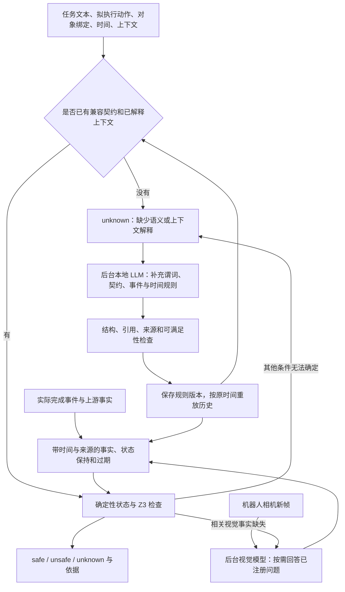

# 学习纪念：面向 VLA 的异步语义补充与形式化安全检查原型

> 学习归档。本仓库保存探索阶段的旧方案，作为学习纪念，不代表已验证的机器人安全系统。研究方向现已转向。
>
> 代表性成果、失败记录及验证边界见 [learning_results/README.md](learning_results/README.md)。未上传模型权重、第三方仓库、下载的数据集与图像；本地完整实验记录另行保留。下文描述的是归档时旧实现，命令与模型配置供历史复核使用。

本文供项目讨论与实现核对使用，区分**当前已实现**、**希望达到的效果**和**尚待决定的设计**。当前没有完成真实机器人或 π0.5 的闭环安全实验。

## 1. 想解决什么问题

机器人执行家庭任务时，危险往往与之前的行为有关。例如，夹爪接触水后再进行有带电接触风险的插接操作；接触污染物后再接触饮用容器的入口。单看当前动作，可能忽略之前留下的湿润、污染等状态。

我们的目标是：利用本地 LLM 理解任务、常识和状态变化，逐步扩展可执行的安全规则；由确定性程序维护状态，再用形式化工具检查当前动作是否满足已声明的安全要求。

这里有三个相互独立的问题：

| 问题 | 例子 | 主要负责者 |
| --- | --- | --- |
| 应该检查什么 | 哪些条件组合会使当前插接操作危险？ | 文本 LLM 提议规则与契约 |
| 这些条件现在是否成立 | 夹爪是否接触过水？之前的湿润证据是否仍有效？ | 视觉模型、完成事件、事实输入与状态引擎 |
| 已有条件能推出什么 | 已知湿润和接触风险时，安全条件是否成立？ | Z3、状态引擎及执行轨迹监视 |

**形式化工具能检查第三类问题，但不会自动保证前两类问题的答案正确或完整。**这是本项目目前最重要的保证边界。

## 2. 总体架构与当前运行方式



当前有两条后台链路：

- **语义补充**：陌生任务、未解释事件或场景变化等触发本地文本 LLM，提出新知识。
- **视觉事实刷新**：对已经注册的视觉谓词，机器人新帧触发短问答，更新其真值，不需要每帧重新生成整套规则。

同步 `SafetyGuard.check()` 不等待模型推理，只返回当前判断。后台完成后，后续检查使用更新后的规则与状态。只有 `safe` 才 `allowed=true`；`unknown` 不放行该请求。调用方需要决定等待、暂停或执行其他已验证的行为，目前代码不自行控制机器人。

异步解决的是慢模型不占住每次检查的调用链，**不能保证一个从未见过的任务可以不等待就安全执行**。首次语义补充或必要视觉证据未到达时，这个任务仍可能需要等。

## 3. 形式化验证到底在验证什么

### 3.1 当前形式化对象

当前实现使用**绑定到具体对象的布尔谓词、受限逻辑表达式、事件规则和时间规则**。例如：

| 符号 | 含义 | 来源示例 |
| --- | --- | --- |
| `gripper_wet` | 当前模型认为夹爪湿润 | 实际图像证据或已完成的接水事件 |
| `socket_energized` | 当前模型认为目标插座带电 | 明确说明来源的文本事实或普通市电假设 |
| `proposal_exposes_live_contact` | 执行当前提案会产生相关带电接触风险 | 对当前动作及其上下文的语义解释 |

考虑一个明确的示例安全政策：禁止湿润夹爪执行存在带电接触风险的操作。对应危险条件 `H` 和安全条件 `S` 是：

```text
H = gripper_wet AND socket_energized AND proposal_exposes_live_contact
S = NOT H
```

这里的风险通路也需要建模。不能仅因某处存在湿润物体，就把所有动作都判为危险；也不能把“操作普通绝缘插头”与“接触裸露带电部分”在物理上无条件等同。上式是声明的风险政策，具体动作是否满足暴露条件仍取决于模型与输入。

传给求解器的内容是逻辑 AST，例如：

```json
{
  "op": "not",
  "args": [{
    "op": "and",
    "args": [
      {"ref": "gripper_wet"},
      {"ref": "socket_energized"},
      {"ref": "proposal_exposes_live_contact"}
    ]
  }]
}
```

Z3 不直接阅读“洗菜”“湿润”“插插座”等中文，也不看图片；它看到的是布尔变量、已知真值和这条公式。谓词名称对求解器只是符号。

当前 AST 支持 `and / or / not / implies`。**尚未实现任意一阶谓词逻辑、量词、通用程序证明或连续动力学验证。**时间主要由状态引擎处理，未作为任意实数时间约束送入 Z3。

### 3.2 safe / unsafe / unknown 的逻辑含义

设 `B` 为当前已知事实，`S` 为这次要检查的安全条件：

| 求解问题 | 结果 | 当前输出 |
| --- | --- | --- |
| `B AND NOT S` 是否可满足 | 不可满足，所有符合已知事实的情况都满足 S | `safe` |
| `B AND S` 是否可满足 | 不可满足，所有符合已知事实的情况都违反 S | `unsafe` |
| 上面两式均可满足 | 已知信息允许安全和不安全两种情况 | `unknown` |

若求解器在预算内不能完成所需证明，代码也可能返回 `unknown`。当前 `Proof` 没有进一步单独报告求解器超时和信息不足，不能把所有 unknown 都解释成“缺一条常识”。

例如，固定 `proposal_exposes_live_contact=true`：

| 夹爪湿润 | 插座带电 | 检查结果 | 原因 |
| --- | --- | --- | --- |
| true | true | unsafe | 已知危险组合成立 |
| false | unknown | safe | 对这条政策，湿润这一必要条件已排除 |
| unknown | false | safe | 对这条政策，带电这一必要条件已排除 |
| true | unknown | unknown | 带电与不带电两种情况都可能 |
| unknown | true | unknown | 湿润与不湿润两种情况都可能 |

因此，“存在未知谓词”不一定导致整个公式 unknown；要看这个未知量是否影响公式结果。unknown 时的反例是**可能的赋值**，不能当成摄像机已经看到的事实。

### 3.3 pre / hold / post 分别检查什么

每个动作契约有三个条件：

- `pre`：执行前应成立的条件。
- `hold`：执行期间应保持的条件。
- `post`：完成后应成立的条件。

开始阶段检查 `pre AND hold`；执行中检查 `hold`；结束阶段检查 `post AND hold`。`begin()` 仅在开始检查通过后登记执行上下文，`finish()` 检查后置条件和提供的执行轨迹，已观察到的保持条件违规不会因后来恢复正常而消失。

当前是**Hoare 风格契约的运行时检查**。它没有对机器人控制程序 `C` 证明完整的 `{P} C {Q}`，也没有证明实际执行必定达到后置条件。结束阶段返回 `unsafe` 还可能表示后置条件未满足，不能一律解释为已经发生物理伤害。

RTAMT 用于检查输入的分段状态报告。它不补全未观测的运动，不证明两帧之间没有危险，也不提供完整物理系统的时序模型检查。

### 3.4 最重要的盲点：漏写规则未必产生 unknown

假设真实风险与湿润有关，但当前契约只写了“夹爪没有碰撞”，且这一条件已知成立，那么求解器可以返回 safe。

它不会主动询问“是否还漏了湿润、电气或污染规则”。如果 LLM 把危险条件写成常量 false，编译后得到安全条件 true；仅凭结构和可满足性检查，也无法认定它漏了危险。

需要区分两种情况：

1. **公式引用了某个已声明谓词，但它的值未知**：求解器可能得到 unknown。
2. **危险谓词或规则完全没有进入公式**：求解器没有相应检查义务，可能得到 safe。

若公式引用的是未声明的谓词，候选校验器会拒绝它，不会把非法表达式直接交给在线求解器。

所以，当前 safe 的准确含义是：**在目前声明的规则与接受的事实下，这次检查成立。**它不能替代对规则覆盖范围、语义正确性及观测可靠性的检查。

## 4. unknown 从哪里来，是否与文本有关

**与文本有关，但不只与文本有关。**当前统一输出 unknown，内部实际包含语义缺失、事实不足、上下文过期和工程状态等不同原因。

| 类型 | 当前触发条件 | 典型原因字符串 | 后续处理 |
| --- | --- | --- | --- |
| 文本未映射 | 任务、动作及对象绑定尚无对应契约 | `unmapped_task_or_action_text` | 尝试提交后台语义补充 |
| 历史未解释 | 新完成事件没有匹配规则，或输入事实的谓词尚未声明 | `uninterpreted_event_or_fact` | 尝试解释事件并补规则 |
| 上下文未解释 | 场景语义或请求 context 与已有解释不一致 | `uninterpreted_scene_or_action_context` | 尝试重新解释上下文 |
| 公式不能确定 | 当前事实不能推出公式真或假 | `formal_condition_underdetermined` | 可尝试补充非视觉事实或规则 |
| 视觉值缺失 | 所缺事实都属于已注册视觉谓词 | `visual_predicates_pending` / `visual_predicates_need_fresh_evidence` | 等视觉后台或新帧，不把它们交给文本模型猜真值 |
| 执行历史不足 | 缺少对应 begin，或保持条件曾经无法确定 | `missing_or_mismatched_execution_context` 等 | 保持不放行，检查执行记录 |
| 系统暂不可用 | 正在发布状态、历史或状态转移预算耗尽等 | `state_publication_in_progress` 或具体 fault | 等待或处理故障，不应靠编造规则消除 |

事实过期、同一时刻观测冲突、规则效果冲突或未知守卫下的可能状态变化，可以先使单个谓词变为 `None`，再使相关公式得到 unknown。

不是每一次 unknown 都会产生新的模型调用。后台有去重、队列和尝试预算，也可能返回 `already_attempted`、`queue_full`、`unresolved` 或错误。`pending=false` 也不等于 safe，应检查最终 value 和原因。

### 4.1 文本映射目前确实包含确定性的缓存匹配

当前映射键为：

```text
规范化后的 task + 规范化后的 action + 排序后的对象绑定
```

规范化处理大小写、空白和部分标点，不会理解“去洗菜”和“清洗蔬菜”语义相同。缓存未命中时，包装层返回 unknown，LLM 在后台解释文本、提出新契约或建议复用兼容契约。复用仍受任务与对象绑定兼容性校验约束。

因此需要分别理解：

- **查找已学过的文本对应关系**：当前使用确定性的字符串键。
- **第一次理解文本并建立关系**：由本地 LLM 完成，仍可能耗时且可能出错。
- **以后根据事实推导状态和检查条件**：由确定性程序和求解器完成。

这不是通过比较字符串“湿”或“开水龙头”来直接判危险。但当前也没有一个已经验证可靠、能免去 LLM 的通用新文本语义识别器。新表达、新绑定或新上下文仍可能触发慢路径。

### 4.2 计划文本不等于实际状态

“接下来洗菜”可以描述一个计划，不能自动证明夹爪已经湿润。“打开水龙头”完成，最多直接支持水龙头开启；夹爪是否被淋湿还取决于接水证据，不能无条件使用 `faucet_on -> gripper_wet`。

合法的状态来源可以是：明确的完成事件、结构化事实、机器人图像得到的视觉回答，或带依据和来源的非视觉语义推断。若由 LLM 阅读完成报告得到事件含义，这个解释也属于模型假设，不能冒充独立测量。

## 5. 当前代码的具体实现

### 5.1 输入与输出

| 数据结构 | 主要字段与用途 |
| --- | --- |
| `ActionRequest` | task、action、at_s、bindings、phase、execution_id、context；表示拟检查的动作，不代表动作已执行 |
| `Scene` | 场景描述、对象、图像、不确定性、采集时刻及语义更新标记 |
| `Event` | 事件符号、对象、时刻、completed、来源和可选描述；只有已完成事件产生规则效果 |
| `Fact` | 谓词、bool 或 None、原时刻、来源、依据、有效期和证据 ID |
| `Verdict` | safe / unsafe / unknown、原因、规则版本、契约、证据、反例及 allowed |

`context` 可携带上游动作片段、已有形式化结果等额外 JSON。目前没有自动将任意 π0.5 数值动作向量转成物理语义的通用适配器，动作维度与单位仍需上游说明。

### 5.2 LLM 输出的知识

候选包括 `reuse / extend / unresolved` 模式、谓词、事件规则、时间规则、契约、推断事实和依据。谓词分为：

- `state`：真实世界状态，例如湿润或污染。
- `proposal`：当前拟执行动作会涉及什么，例如将触碰容器入口。
- `disposition`：相对稳定的属性或能力，例如普通市电设备具有电气危险。

本地模型生成 `pre_hazard`、`hold_hazard`，表示危险成立的条件；确定性编译器取反，得到内部 pre、hold 安全条件，避免混淆“危险为真”和“允许执行为真”。post 表示完成条件。

候选校验检查字段、AST、对象绑定、谓词引用、效果类型、时间范围、条件可满足性和证据引用等。已有定义不能被静默改写，视觉查询门控不允许循环依赖。

这些检查可以拦截结构错误、部分逻辑矛盾和不合法来源，**不能证明 LLM 提出的常识是真实定律，也不能证明相关危险已经列全**。

### 5.3 状态由程序保存，不由模型反复记忆

事件规则的形式例如：

```text
已完成的 water_contact(gripper)
    -> gripper_wet = true
```

当该事件及对应规则都存在时，状态引擎更新并保存 wet。单纯输入“准备接水”不会产生这个变化。

时间规则由锚点、锚点取值、持续时间、守卫和效果构成。锚点的新 revision 可以重新计时，锚点失效会取消旧计时。来源冲突和不能确定的效果会保留为未知。

规则推导的普通状态持续到后续规则或明确观察改变，不自动继承一个任意的短观测有效期。视觉谓词则使用下一节的显式保持机制。旧事实和迟到模型结果按原采集时间回放，再应用之后的已记录更新。

当前世界状态保存在单个 `SafetyGuard` episode 内存中；catalog 规则版本可以保存并复用。重建 guard 不会自动恢复上一个 episode 的真实世界状态，不能把规则持久化理解成跨重启的世界状态持久化。

### 5.4 视觉谓词：持续询问与五分钟续期

LLM 可以给谓词注册如下描述符；这是接口示例，不是已经测得准确率的湿润检测器：

```json
{
  "method": "visual_question",
  "question": "Is the robot gripper physically wet? Use unknown if this cannot be established.",
  "yes_value": true,
  "when": true,
  "query_interval_s": 1,
  "true_hold_s": 300,
  "false_hold_s": 1,
  "max_frame_age_s": 2
}
```

| 字段 | 实际含义 |
| --- | --- |
| `question` / `yes_value` | 询问内容及 yes 对应的谓词值，支持问题的反向极性 |
| `when` | 是否需要询问的逻辑条件；如只在 wet=true 时询问另一个相关视觉属性 |
| `query_interval_s` | 同一谓词两次使用新采集帧的最小间隔 |
| `true_hold_s` / `false_hold_s` | 新真值从采集时刻起保留多久 |
| `max_frame_age_s` | 入队时允许的图像年龄 |

当前可执行的 evaluation 方法只有 `visual_question`；LLM 不能通过这个字段提交任意 Python 计算程序。

湿润状态的当前语义为：

| 时刻 | 收到的有效视觉结果 | 保存的状态 |
| --- | --- | --- |
| 10 秒 | true | 湿润保持到 310 秒 |
| 20 秒 | true | 重新延长到 320 秒 |
| 30 秒 | no | 保留已有 true，不提前清除，也不延长 |
| 40 秒 | unknown 或遮挡 | 保留已有 true，不延长 |
| 320 秒 | 没有更新的有效证据 | 变为 unknown，不变成 false |

wet=true 时仍继续询问新帧，目的包括发现新的湿润证据并续期。当前没有实现“识别擦干动作后可靠地提前解除湿润保持”的专门机制；普通的视觉 no 不能直接解除未到期的 true。

新帧通过 `observe_frame()` 驱动查询，不要求每次重新解释整个场景。没有新帧时不重复使用旧图续期；每个谓词最多一个在途查询，完成后检查最新帧和门控依赖。模型生成的视觉谓词不能由文本推断、静态默认值或定时器直接赋予确定真值。

这里的五分钟是保守记忆政策，不是经过验证的自然干燥时间。1 秒询问间隔是调度设置，不代表本机已经达到 1 Hz。若真实推理延迟超过短期结果的有效期，结果可能在到达时已过期，系统仍会 unknown；离线冻结时钟的演示不能掩盖这个部署问题。

### 5.5 模型与模块

当前所有模型推理都在本地。配置为文本 `qwen3.5:9b`、独立视觉 `qwen3-vl:4b`；不调用云模型 API。

FineART 原生 `select_message()` 的适配接口已编写，但没有完成本机原生权重加载和真实湿润问答验证。公开 FineART 权重是 subtask-midtrained checkpoint，模型卡明确不据此保证通用 VQA 能力。不能把架构支持语言输出当成安全谓词识别已经可靠。

| 文件 | 当前责任 |
| --- | --- |
| [types.py](safety_guard/types.py) | 输入、事实、事件、场景与结果结构 |
| [logic.py](safety_guard/logic.py) | 布尔 AST、Z3 蕴含检查、RTAMT 轨迹监视 |
| [state.py](safety_guard/state.py) | 状态保存、事件效果、计时、过期与时间回放 |
| [catalog.py](safety_guard/catalog.py) | 候选校验、文本映射键、版本、来源与回滚 |
| [local.py](safety_guard/local.py) | 本地模型接口、语义生成、非视觉事实实例化与视觉问答 |
| [worker.py](safety_guard/worker.py) | 语义补充队列、去重、有限修复和审计 |
| [predicates.py](safety_guard/predicates.py) | 视觉查询队列、门控、刷新与 FineART 接口适配 |
| [runtime.py](safety_guard/runtime.py) | unknown 分流、在线判断、后台发布和执行生命周期 |
| [cli.py](safety_guard/cli.py) | 小规模 JSONL 回放 |

规则候选、模型原始调用、拒绝原因、事实依据、图片哈希和判断记录均有相应审计入口。可追踪不等于语义已经得到独立验证。

## 6. 一个完整的预期过程

下面描述目标运行过程，**不是已完成的真实视觉模型实验成绩**。

1. 输入“打开水龙头”。若文本尚无映射，先返回语义 unknown，后台 LLM 建立相关契约及事件含义。
2. 系统收到实际完成报告，更新 `faucet_on`。仅此还不能确定 `gripper_wet`。
3. 后续机器人图像或明确接水事件提供夹爪接水证据，状态引擎建立并保持 wet；如果画面只显示杯子接水，夹爪证据不足，就不能自动建立 wet=true。
4. 输入拟执行插接任务。若是新文本或新绑定，仍需先补充语义；已有 wet 状态不会自动让陌生动作获得安全契约。
5. 契约明确了带电假设和接触通路后，求解器根据 wet 等当前事实检查危险组合。条件成立则返回 unsafe 和支撑前提，VLA 或上层规划器据此处理。
6. 后续每个合适的新帧仍可触发湿润问题。新的 true 续期，暂时看不清不清除已有风险记忆；保持到期后未知状态阻止无依据放行。

目前返回的是结构化判断与证据，**没有完成将证据自动改写成 VLA 新任务、重新执行并确认避险的闭环**。

## 7. 是否改成定时补充规则

### 7.1 当前已实现的调度

规则补充主要由 unknown 和上下文变化驱动；视觉事实刷新由新帧、查询间隔及门控驱动。当前没有运行一个“即使一直 safe，也每隔固定时间全面审查规则”的后台任务。

### 7.2 建议采用的下一步方案：增加定期审查，保留 unknown

定时补充值得考虑，因为遗漏的危险规则不一定触发 unknown。但它适合作为额外的规则覆盖检查，而不是直接替换已有的未知状态处理。

| 机制 | 要解决的问题 | 建议的触发方式 | 是否已实现 |
| --- | --- | --- | --- |
| 形式化检查 | 当前动作是否满足当前安全条件 | 每次动作请求和执行状态检查 | 已实现接口 |
| 视觉事实刷新 | 已有谓词的当前值是否有新证据 | 新帧、按需、受模型吞吐限制 | 已实现 |
| 语义缺失补充 | 没有任务映射、没有事件解释等 | 遇到相关 unknown | 已实现 |
| 规则覆盖审查 | 当前模型是否漏掉危险类别、状态或依赖 | 新任务阶段、显著场景变化；可另加低频定时审查 | 尚未实现完整覆盖审查 |

例如可以实验每 30–60 秒审查一次任务计划、近期历史和当前规则，提出增量补充；间隔应由实际耗时和风险窗口决定，目前没有把这个数值验证为合适频率。审查任务应去重并限制并发，不能无限积压。

还可以在执行前预先解释已知任务队列，减少首次使用时等待；这也属于建议，当前没有专门的预注册工作流。预先理解计划不能预先把未来行为当成已完成事实。

无论是否定时，都应把“补规则”和“刷新事实”分开：前者较慢，后者需要根据新观测及时更新。仅把每 50 秒运行一次大模型，不能保证两次审查之间不漏危险；相机看不清或事实冲突也不会因为定时器运行而自动变得确定。

定期审查同样依赖 LLM，仍不能形式化证明规则完备。不过它能补上当前“只有显式 unknown 才请求新知识”的一个明显缺口。

## 8. 数据源、当前困境与小规模实验目标

### 8.1 已经找到的可用数据

| 数据源 | 实际核实内容 | 当前用途与限制 |
| --- | --- | --- |
| [DROID](https://huggingface.co/datasets/cadene/droid) | 已下载并查看 episode 59 的三个相机视频和同步动作／状态；任务是把白杯放到流水下 | 优先用于 π0.5 相关输入；OpenPI 有 pi05_droid，但演示不因此成为 π0.5 rollout |
| [Mobile ALOHA 洗锅](https://huggingface.co/datasets/lerobot/aloha_mobile_wash_pan) | 50 条真实演示，含顶端和双腕相机；已下载顶端视频并抽取 episode 49 | 更贴近 ALOHA 具身形态；不是现成的 FineART 或 π0.5 安全测试 |
| [RoboCasa365](https://github.com/robocasa/robocasa) | 源码有 WashLettuce、SoakSponge 和龙头操作；检查了接水判据 | 可构造有明确抽象接水事件的测试；没有物理准确的夹爪干湿与干燥模型 |
| [BridgeData V2](https://rail-berkeley.github.io/bridgedata/) | 任务表和 episode 中有龙头、海绵清洗操作 | 补充候选；尚未实际查看这些候选片段 |

具体 episode、固定数据版本、下载文件和 SHA-256 见 [机器人数据源说明](docs/ROBOT_DATA_SOURCES.md)。本地资料保存在 `results/robot_data_sources_20261107/`。

### 8.2 困境不在于没有机器人视频

现成 VLA 数据主要用于学习任务执行，通常缺少以下标注或测试协议：

- 夹爪究竟接触了水，还是只有夹持物体接触水。
- 物体是否污染、湿润状态是否持续，以及何时有足够证据确认状态改变。
- 当前哪些属性视觉可见，哪些只能作为文本假设。
- 同一连续历史下，某个后续动作为什么危险及对应的独立参考答案。

任务叫“洗锅”不能直接提供夹爪 wet=true 的真值；单帧没看到水珠，也不能直接提供 physically_dry=true。插座实际带电通常也不能由外观确认，代码可接受明确说明的普通市电风险假设，但应将它计入评估前提。

因此需要少量人工核对的状态／接触证据，或者明确采用仿真抽象事件作为参考。图像和动作日志可直接利用，安全真值不能凭任务名自动生成。

### 8.3 希望先达到的效果

初期只需少量片段，重点看链路是否有效：

1. 有明确接水证据时，建立正确的对象与状态关系，而不是只检测到了水龙头。
2. 切换任务后，状态仍由程序保存，不要求模型重新回忆整段历史。
3. 面对遮挡、过期和冲突，区分已知风险与真正缺少信息，不随意给出 safe。
4. 对后续拟执行动作返回可追溯到具体规则、事实及原时刻的判断。
5. 测量真实语义补充和视觉问答延迟，确认保持时间与刷新频率能否在当前设备上工作。

若追加“接水后准备插电”的离线提案，需要明确这是在现有历史上的反事实检查。不能拼接不同 episode 并宣称机器人实际连续执行了该危险任务，更不能据此报告闭环避险成功率。

## 9. 当前证据、未完成项与讨论重点

已有两个顺序任务的旧开发记录，以及 SafetyBench Physical Health 的十题开发实验；它们包含测试驱动修改，部分历史输入是结构化或手写事件，不能作为新视觉架构的独立泛化结果。

原始文本任务试跑也出现过错误 safe、unknown 和中途停止，不能只保留成功样例来描述系统能力。相关记录仍保存在 `results/wash_tasks_raw_20261107/`。

最近一次代码工程测试为 **68 项通过，4.880 秒**，日志见 [测试记录](results/visual_predicates_20261107/unit_tests.txt)。其中视觉链路使用明确标注的合成回答及 HTTP mock，证明状态、门控、异步与接口行为，不证明视觉识别准确率。本次 README 更新没有重新运行模型或大规模测试。

DROID 和 Mobile ALOHA 的视频已实际下载、解码并查看；尚未用这些视频完成真实模型的“湿润识别→规则维护→后续动作判断”实验。FineART 的原生语言头也尚未完成真实推理验证。

建议优先决定：

| 决策 | 为什么重要 |
| --- | --- |
| 目标是在线检查已有安全规则，还是主动发现遗漏规则 | 前者已具备基本工程框架，后者需要额外的规则覆盖审查与评估 |
| 哪些事实可由文本假设，哪些必须由实际历史或图像支持 | 决定形式化结论的前提是否可信、评估是否可解释 |
| unknown 补充之外是否增加定期或任务阶段审查 | 直接影响“漏规则但仍输出 safe”的风险 |
| 先做离线安全检查，还是接入 VLA 闭环 | 两者的数据、时延要求与能够宣称的效果不同 |
| 干湿状态的参考标注采用什么标准 | 决定我们测到的是物理湿润、接水暴露还是单纯可见水迹 |

## 10. 运行与进一步阅读

项目使用独立 Python 3.12 环境 `.venv312`，依赖和本地模型配置见 [部署说明](DEPLOYMENT.md) 与 [llm_local_config.json](llm_local_config.json)。原有环境、模型、检查点和旧实验成果保留。

工程测试入口：

```powershell
.\.venv312\Scripts\python.exe -m unittest discover -s tests -v
```

显式使用手写候选的状态机演示，不调用模型，也不代表模型效果：

```powershell
.\.venv312\Scripts\python.exe -m safety_guard replay examples/wet_socket.jsonl --proposal-file examples/wet_socket_contract.json --catalog results/demo_catalog --output results/demo.jsonl --wait
```

该旧 fixture 中的 10 秒受控干燥是假设性的工程测试规则，不能当作本项目当前湿润状态的真实干燥时间或视觉保持政策。

本地模型回放入口：

```powershell
powershell -ExecutionPolicy Bypass -File scripts/start_ollama.ps1
.\.venv312\Scripts\python.exe -m safety_guard replay examples/local_tap.jsonl --local --catalog results/tap_catalog --output results/tap.jsonl --wait
```

`--wait` 仅用于离线等待后台结果；真实运行的 `check()` 不阻塞等待 LLM。每次独立实验应使用新的 catalog 目录，复用目录表示继续使用已有规则，不等于恢复旧世界状态。

进一步材料：

- [状态与后台发布细节](docs/DESIGN.md)。
- [视觉谓词接口与限制](docs/VISUAL_PREDICATES.md)。
- [真实机器人数据源与已下载样例](docs/ROBOT_DATA_SOURCES.md)。
- [两个顺序样例的旧开发记录](docs/SEQUENCE_EXAMPLES.md)。
- [十题开发实验结果](results/safetybench_physical_10_20261106/REPORT.md) 与 [剩余问题](results/safetybench_physical_10_20261106/FINDINGS.md)。
- [相近实现、论文和实验口径](docs/RELATED_IMPLEMENTATIONS_20261106.md) 与 [资料来源](docs/SOURCES.md)。
- [旧实验统一归档](experiments/archive_20261106/README.md)。
