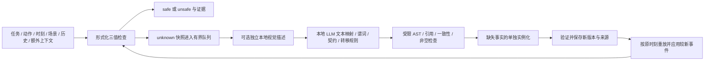

# 实现内容与设计理由

当前总体方案、unknown 的精确含义、形式化保证边界及定期规则审查的讨论，以根目录 [README](../README.md) 为入口。本文中的普通事件状态维护与后来新增的视觉保持机制需要区分，后者见 [视觉谓词](VISUAL_PREDICATES.md)。定期全面规则审查目前属于建议，尚未实现。

## 一、现在做了什么



### 数据与模块

| 文件 | 责任 |
| --- | --- |
| `types.py` | 事实、完成事件、场景、请求、三值结果与更新时间结构 |
| `logic.py` | 受限 AST、Z3 三值蕴含、STL 编译及 RTAMT 轨迹检查 |
| `state.py` | 增量状态机、事件效果、锚定计时器、知识过期、历史重放 |
| `catalog.py` | 候选结构与一致性检查、不可变版本、哈希指针及回滚 |
| `local.py` | 本地结构化模型接口、语义提示、事实实例化、可选视觉描述 |
| `worker.py` | 有界异步任务、去重、一次候选修复、审计和版本提交 |
| `runtime.py` | 同步检查、场景/事实/事件入口、执行生命周期、后台结果发布 |
| `cli.py` | 小规模 JSONL 回放，明确区分手写候选与真实本地模型 |

### unknown 的来源

1. 任务/动作文本和对象绑定没有对应的已知契约。
2. 已有公式在当前已知事实下既可能真也可能假。
3. 新场景文字/图像或动作额外上下文尚未解释，旧语义解释不能直接覆盖它。
   新出现且没有匹配转移规则的完成事件、尚未声明的事实，也会使已有文本解释失效，触发异步补充。
4. 事实过期、来源冲突、未知条件下可能发生的状态转移。
5. 缺少执行上下文、历史/计时预算耗尽或状态发布暂时占用。

RTAMT 的 robustness 不是 unknown 的全部来源。缺语义和缺事实由包装层及 Z3 显式表达。只有 safe 才 `allowed=true`，unknown 不放行该动作；其他已有确定模型的独立动作仍可检查。

### 语义候选

候选包含 `reuse / extend / unresolved` 模式、谓词列表、事件规则、时间规则、pre/hold/post 契约、时间化推断事实和依据。谓词绑定具体 subject。契约绑定原始 task、action 和对象映射；同义 action 可复用兼容契约。

本地模型生成接口明确使用 `pre_hazard / hold_hazard`，表示执行拟议动作会造成危险的条件；编译器统一取反得到内部 pre/hold 安全公式，降低把危险条件写成放行条件的方向错误。模型输出的 `post` 仍表示任务完成，不因任务危险而写成 false。未知动态默认值由 schema 固定为 null，当前真值使用带时间和依据的事实。

执行前危险条件必须结合当前物理状态和拟执行动作的暴露/转移途径，不要求伤害已发生或动作已完成。模型可以从动作文本得到“这个提议将触碰杯口”这样的计划属性，但不能据此把“已经触碰杯口”当成执行事实。新生成谓词显式声明 `kind=state / proposal / disposition`，区分实际状态、当前提案属性和常识能力；历史定义缺省为 state。事件/时间效果只能改变 state，计时器也只能锚定 state。类型合法不等于语义分类正确，原始依据仍需审查。

本地模型输出只负责契约内容；task/action/bindings 由编译器从请求原样填入，避免引号或对象抄写造成错误。修复轮除文字反馈外，可将已声明谓词、允许的 state 效果/锚点写入 JSON schema；最终仍经过完整确定性校验。结构合法、满足公式与常识正确是三个不同层面。

布尔 AST 仅接受：

```json
{"op":"not","args":[{"op":"and","args":[{"ref":"hand_wet"},{"ref":"socket_live"}]}]}
```

不执行 LLM 代码，不接受自由公式字符串。STL 由同一 AST 编译，避免由模型分别输出两份未经证明等价的公式。当前不提供任意量词、数值动力学或未来 STL 合成。

引用必须存在，表达式和规范库有大小上限。候选不得静默覆盖现有定义；规则冲突在运行时给出 unknown。新契约的 pre/hold 与 post/hold 必须可满足。受到事件或计时效果修改的谓词必须以 null 为默认值，实际初始事实放入 `inferred_facts`。固定默认前提不能使契约一开始就不可满足，否则拒绝并要求修复。

### 事实实例化

启用 `interpret_completed_events` 时，后台先独立解释尚无匹配规则的完成报告。
事件名可以是 `record_001` 这样的无语义编号；模型读取原始活动描述及该时刻之前的场景和历史，提出持久状态变化。
这个步骤不接收后续待检查任务，明确区分直接报告、常识假设和未知，不把清洁等同于干燥。
输出是带原始来源引用的候选语义，不直接写入世界状态；随后由契约生成阶段编译成谓词与事件规则，经过原有校验和历史回放才生效。
解释按完整输入内容缓存；已存在匹配事件规则时跳过该步骤。当前是对具体记录的语义补充，并非已经实现通用的参数化动作分类器。
这不同于已移除的 `semantic_reading` 实验：这里只解释已完成历史，不预读当前动作，也不生成安全标签。

规则生成后，先在采集快照上重放事件。如果相关检查仍 unknown，单独询问本地文本模型每个缺失谓词的布尔值、原时刻、依据、有效期。文本模型获得原始场景、完整历史、可选视觉描述、扩展规范库及已有形式化诊断；求解器的反例赋值明确标为假设，不是观测。

普通市电插座可以依据常识推断带电，不要求传感器证明，但证据来源明确为 `llm_inference`。没有依据的事实返回 null。拟执行动作不能被当成已经实现的后置状态。实例化后再次检查候选；放行仍由当前状态上的确定性形式化检查决定。

### 事件、时间与冲突

- 仅 `completed=true` 的事件产生效果。事件守卫在同时效果应用前求值。
- 守卫为 unknown 时，把可能效果和原状态合并；不同可能真值得到 unknown，不能静默跳过改变。
- 同一时刻独立观测互相矛盾，或同一事件的规则效果冲突，产生 unknown。事件/计时推导之后收到的明确观测可以更新状态，不被误当作两个独立观测冲突；顺序完成事件仍按 sequence 更新。
- 计时器为 `(rule_id, anchor_revision)`：锚点新值/新版本重新计时，失去锚点值取消旧定时器。
- 计时规则在期限上只检查一次；守卫为 false 不执行，unknown 产生不确定效果。不是“无限等到守卫成立”。
- 事件与计时期限相同时，先处理已输入的该时刻事件，再触发剩余有效计时。若调用方已经在该时刻先行检查，返回值只反映那次调用前已提交的信息。
- `Fact.valid_for_s` 是观测/初始推断的知识有效期；到期变为 unknown，绝不自动取反。过期时刻也进入 hold 轨迹。
- 事件和时间规则推导的状态不继承谓词声明的 `valid_for_s`，由确定性状态机持续保存，直到反向完成事件、明确观测或显式时间规则更新。新模型声明的谓词强制使用 `valid_for_s=null`，避免把10秒观测有效期误当物理状态寿命；旧catalog中的短有效期也不再附加到规则效果上。
- 普通 `llm_inference` 不能覆盖已经由规则推导的状态，也不能代替独立证据消解规则冲突。初始信息或尚未能由规则确定的状态仍可由模型实例化；明确的新观测可以通过事实入口输入，或通过补充观察事件对应的规则更新。
- 干燥时间由 LLM 根据上下文提出，运行时不硬编码。没有可信时间规律时允许不提出时间翻转；手写示例的 10 秒是明确的合成测试假设。

`llm_local_config.json` 的 `state_memory_reference_s=300` 给语义生成和事实实例化提示加入约5分钟的手湿时长参考。它不是300秒知识TTL，也不会在300秒自动变干。模型根据上下文提供有依据的事件/时间转移，确定性层负责执行；污染状态不因为等待5分钟就被视为清洁。

例如：模型提供 `water_contact(right_hand) -> hand_wet=true`，系统记录接触事件后自行得到并保存真值；之后换成插插座任务，形式化检查直接读取该状态。对于普通事件维护的状态，不需要模型反复回忆之前的真值。后来新增的视觉谓词机制则持续询问新帧：新的 true 从采集时刻续期，普通 no 不清除未到期的 true，保持到期转为 unknown；不能用时间规则直接把视觉谓词翻转成 false。

### 时间回放与发布

普通事件/事实在已加载规范上增量执行，快路径不重放全部历史。后台得到新语义后，使用完整记录按 `(原时刻, sequence)` 重建状态；采集之后的新事件会继续应用。相同时刻的明确事实不会被模型推断覆盖，冲突也不会由模型任意消解。

后台先写未激活的 catalog 和 provenance，完成回放、并发事件追赶及执行监视准备，再检查规范 generation 并原子替换磁盘活动指针，在同一运行时锁内切换已准备的状态。常规回放或预算检查失败时，活动规范和运行状态均保持原版本，失败候选只保留为未激活记录；这不是跨进程事务或断电恢复协议。正在发布时同步检查可以立即返回 unknown。catalog 版本、模型调用、拒绝原因和候选保存在后台目录。回滚后新提交仍分配更大的版本号，旧版本不被覆盖。

执行上下文固定开始时的契约；回放重建替换轨迹而不重复追加，已观察的 hold 违规和曾经 unknown 的标记保留。规则候选和缺失事实实例化共用有限修复预算，错误的实例化响应也会反馈给本地模型。模型原始调用记录在 job 审计成功落盘后释放内存。

Z3 对 safe/unsafe 返回不可满足核心对应的支撑前提，不承诺最小证据集合；unknown 保留引用事实。已证明 safe 时直接返回，不再进行另一方向的求解。反例赋值是求解器构造的假设，不能当成实际观测。

### 视觉入口

`Scene` 可直接提供详细结构化文本，亦可给本地图片路径。图片仅在后台读取、校验和编码，视觉模型输出详细对象、状态、关系和不确定性。视觉报告作为单独来源保留，不冒充测量真值；隐藏电源、温度等不能仅凭图片描述声称已证实。视觉和文本模型可以分别配置。

默认新场景内容需要语义解释；完全由上游结构化适配器负责语义变化时，可设置 `interpretation_required=false`，但调用方必须通过事实/事件反映相关状态变化。图片路径相同不代表像素相同，因此带图片的新场景仍视为需要解释。

## 二、为什么这样做

- **SkiROS2**：将开始条件、执行中条件、完成条件分开；仅在结束时拒绝提交结果无法撤销已发生的物理危险。
- **ToolGate**：把模型输出收束到可执行契约接口。其正确性仍以契约可靠为前提，不能外推成 LLM 常识自动可靠。
- **VIRF**：逻辑层约束生成层、未知信息驱动知识更新。这里允许异步自动建议规则，因此明确保留经验推断的来源和保证范围。
- **Deductive Steering**：模型提议，验证器给出具体反例或结构错误供修订。这里使用有限候选修复，不把长时间树搜索放入每次控制检查。
- **pytransitions**：借鉴守卫、显式事件以及状态相关计时器取消的工程组织，具体状态机独立实现以适配三值与原时刻回放。
- **RTAMT / Z3**：分别负责给定轨迹的时序监视和不完全布尔事实下的逻辑蕴含；二者作用不同，不以一个模块冒充全部安全证明。

## 三、当前能够证明什么

Z3 证明的是输入事实对已声明公式的蕴含/否定；RTAMT 检查的是输入的分段状态轨迹。它们不证明新常识与真实物理世界一致，不证明动作抽象准确，也不证明摄像机没有漏看风险。

本轮没有引入人工审核作为运行前提，也没有宣称已经获得可认证的安全系统。模型推断直接进入实验模型，因此结果具有明确的模型前提。缺少独立语义锚点时，这个限制无法用语法检查或同模型反复自检消除。

目前只做小规模工程测试和开发场景诊断，包括两个历史依赖顺序样例，不做准确率、消融或 VLA 闭环指标宣称。老实验成果单独归档，不能当成新方法的验证结果。
